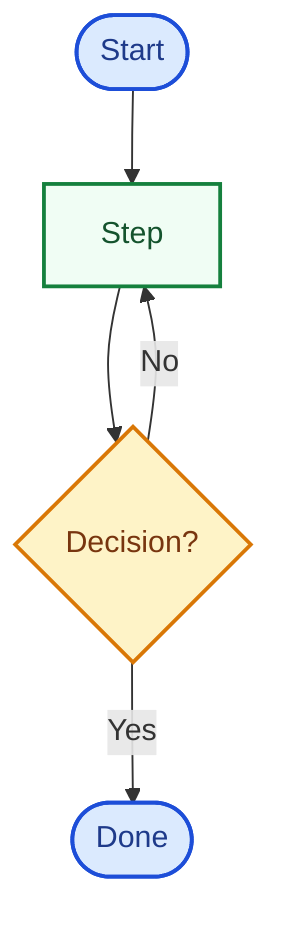

# PHP OOP Visual Maps (PHP 8.5+) - See the System

## Who This Is For

Student profile: finished the PHP OOP lecture track and the interview-questions track.
Ready to turn verbal understanding into clear diagrams before building the final project.

---

## Visual Maps Track (12 Maps, One Per Session)

Start this track only after the Interview Track Review Checklist in `../02-Interview-Questions/README.md` is complete. Deliver exactly one map per session unless the student explicitly asks to continue.

Every map session:
- Restate what concept or flow the map must show.
- Choose the simplest diagram kind that fits (see Map Kind Guide).
- The student draws in `map.md` (Mermaid by default), following Diagram Standards so it looks clear on GitHub.
- Ask one CHECK: the student explains the diagram out loud without reading labels one by one.
- Confirm the diagram renders cleanly when `map.md` is opened on GitHub (or with Mermaid syntax GitHub supports).
- Mark the map with ✅ only after the diagram is accurate, the GitHub view looks good, and the CHECK passes.
- Keep a `Source:` line on every map folder `README.md`.

This track stays inside PHP OOP. Do not teach design patterns or full SOLID theory here; those belong to the separate OOD course. Map 11 is only a one-box "out of scope" reminder, not a SOLID lesson.

### Visual Maps Review Checklist

```
- [ ] Every map from 1 to 12 is marked with ✅ in the progress list.
- [ ] Every map folder has `README.md` and a completed `map.md`.
- [ ] Every map folder `README.md` ends with a `Source:` or `Sources:` line.
- [ ] The final map is an end-to-end system view of a small PHP OOP application.
- [ ] Every completed `map.md` renders cleanly on GitHub (no Mermaid parse error; labels readable at a glance).
- [ ] The student can explain each map in plain English without reading every label.
- [ ] Weak maps were redrawn until the CHECK passed.
```

Do not start `../04-Final-Project/README.md` until this checklist is complete.

### Visual Map Progress

```
Map 01 - Why objects
Map 02 - Class vs object
Map 03 - Visibility
Map 04 - Encapsulation
Map 05 - Inheritance tree
Map 06 - Polymorphism
Map 07 - Interfaces vs abstract
Map 08 - Traits composition
Map 09 - Namespaces and autoload
Map 10 - Exceptions flow
Map 11 - SOLID preview (out of scope)
Map 12 - End-to-end OOP system map
```

---

## Map Kind Guide

| Kind | Use when |
|:---|:---|
| Concept map | Ideas connect to each other |
| Flowchart | A process has ordered steps and decisions |
| Sequence | Actors exchange steps over time |
| State | One thing changes status |
| Layers / placement | Show where pieces live relative to each other |
| Compare | Two options side by side |
| System map | The whole subject in one picture (always last) |

---

## Visual Map Session Cycle

### PLAN
- Name the map and the single idea it must communicate.
- Pick one diagram kind from the Map Kind Guide.

### DO
- Student drafts the Mermaid diagram in `map.md` using Diagram Standards (GitHub-first).
- Tutor reviews accuracy, simplicity (one idea, clear labels), and how it will look on GitHub.

### CHECK
- Student explains the diagram aloud as if at a whiteboard.
- Open `map.md` on GitHub (browser file view): it must render as a clear SVG — no parse error, no cramped sprawl, readable labels.
- One targeted fix if a relationship, order, or GitHub render is wrong.

### ACT
- Mark ✅, update progress in this file, move to the next map.

---

## Diagram Standards

**Acceptance check:** a completed map must look clear when you open `map.md` on GitHub (browser file view). Looking good only in a local Mermaid plugin is not enough.

### Format (what GitHub renders)

- Default: one fenced `mermaid` block inside `map.md` — GitHub turns it into an SVG ([Creating diagrams](https://docs.github.com/en/get-started/writing-on-github/working-with-advanced-formatting/creating-diagrams)).
- Prefer stable kinds GitHub renders well: `flowchart`, `sequenceDiagram`, `stateDiagram-v2`.
- Prefer `flowchart TB` (top → bottom) over wide `LR` layouts — GitHub's content column is narrow.
- ASCII is a fallback only when Mermaid cannot express the idea; it must still read cleanly in the GitHub file view.

### Look and readability

- One primary idea per map. Split if you need a legend longer than the diagram.
- Short plain-English labels (about 2–5 words). Quote labels that contain `()[]{}/|`.
- Prefer clear names over clever abbreviations. PHP keywords only when the map is about that keyword.
- Aim for roughly **4–12 nodes**. More than that usually means two maps.
- Use `subgraph` sparingly; nested subgraphs often look cramped on GitHub.
- Never use `end` as a node id (it breaks Mermaid parsing).
- Style with `classDef` + `class`: pastel fills and **dark text** so labels stay readable on GitHub's light theme.

Style palette to reuse (adapt colors; do not skip styling):



### Do not

- Do not rely on a dark-only theme, custom CSS, Mermaid Live Editor-only features, or screenshot images as the primary diagram.
- Do not pre-draw answer keys in the scaffold (the stub may show a single styled placeholder node only).

---

## Source Reference Rules

- Each map folder's `README.md` must end with a `Source:` or `Sources:` line.
- Use the official PHP Manual when the map is about language or runtime behavior.
- The source line must be the final line in the map folder `README.md`.

---

## Visual Maps Folder Structure

```
03-Visual-Maps/
├── README.md
├── Map-01-why-objects/
│   ├── README.md
│   ├── map.md
│   └── notes.md          ← optional, learner-created
├── Map-02-class-vs-object/
│   ...
└── Map-12-end-to-end-oop-system-map/
    ...
```

---

## Map Folder Rules

Each map folder contains a `README.md` with:
- Status, related lectures, diagram kind.
- What To Show, CHECK, Files, Completion Rule.
- The source reference as the final line.

When a map is completed:
1. Update its folder `README.md` status from `Not completed` to `Completed`.
2. Mark the matching map with ✅ in the progress list in this file.
3. Keep the student's diagram in that map's `map.md`.

`map.md` is a GitHub-valid Mermaid stub (styled placeholder); the learner replaces it with the real diagram. `notes.md` is optional and learner-created.

---

## What Not To Do

- Do not start this track before interview questions are complete.
- Do not require Lucidchart, draw.io, or paid tools.
- Do not teach a full UML syllabus — only the map kinds needed for PHP OOP.
- Do not unlock the final project before the end-to-end system map CHECK passes.
- Do not draw the learner's diagrams for them.
- Do not accept a map that only looks good in a local plugin — the GitHub file view is the acceptance check.
- Do not turn maps into a full SOLID or design-patterns course (redirect to OOD).
